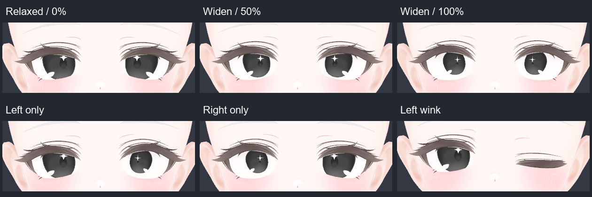

# Milfy FT 1.2.0: 既存BlendShare方式での見開き対応

## 最終構成

従来どおり、配布BlendShareデータからsetup時にFT Meshを生成し、Jerry 7.0.5と既存Shape Adapterで駆動する。新しいNDMF形状生成プラグイン、独自4補正形状、追加Animatorレイヤーは使用しない。既存のEye Sync Separationプラグインは従来どおり。

配布データは39から41形状へ拡張し、追加は `EyeWideLeft` と `EyeWideRight` だけ。各形状に、その側の次の変形を合成している。

- まぶた: `eye_surprised_L/R` の100%。
- 瞳孔: `pupul_small` の50%。
- 黒目全体とハイライト: `eye_op_small_２`（全角２）の40%。星型の大きさと位置も追従する。

係数はネイティブ形状の適用量であり、実際の直径の縮小率ではない。通常開眼・FTオフでは合成EyeWideを0へ戻す。縮瞳も一体化しているため、旧試用案の「実測瞳孔有効時に瞳孔専用補正だけ停止」は廃止した。カスタム瞳孔形状との合成は個別調整が必要。

Unityの頂点とFBXのcontrol pointは番号も座標系も異なる。それぞれのネイティブ左目を基準に左右を分離した。確認したモデルではUnityの左がlocal -X、FBXの左が+X。両経路の出力Meshを比較し、反対側の黒目を縮める誤りを排除した。

## 既存Animatorへの統合

Jerry 7.0.5の `Left/Right Eye Lid Blend`（EyeLid×EyeSquint）をEyeWide曲線だけに限定して、既存 `Milfy FT Shape Adapter` の2分岐として収録。追跡無効側は0を明示する。既存の2レイヤー構成・priority 1100を維持し、追加レイヤーや同期パラメーターは作らない。

WD Offの非正規化Direct BlendTreeでは、未指定propertyが前フレームから加算されるケースを再現した。所有8形状を各末端clipで明示し、担当外は0にした。既存6形状の曲線値は保持し、Jerry本体・既存外部clip・Eye Smile Correction層は変更していない。不要な生成途中clipは除去済み。

## 1.1.xと試用版からの移行

新規setupは41形状を生成する。以前の39形状Meshはパッケージ更新だけでは変わらないため、Hierarchy上のアバタールートを選び、`Tools/suu_MifyFT/Update selected FT mesh to 1.2.0` を実行する。

更新は現在のMeshを複製し、EyeWide2形状だけを配布データで追加・置換する。他の形状、順序、微小な頂点・法線・接線差分、renderer weight、元Meshを保持する。既存EyeWideも置換するため、試用版からも更新できる。Undoで元の割当へ戻せる（生成アセットは残る）。Sceneは自動保存しない。

Prefab Mode/Preview Sceneは拒否する。試用版の `MilfyEyeWidePupil*` / `MilfyEyeWideIris*` が非ゼロなら二重変形を防ぐため停止する。0ならデータを保持し、自動削除はしない。移行後はSceneの保存と再ビルド・アップロードが必要。

## 検証（2026-10-26）

環境: Unity 2022.3.22f1、VRChat SDK 3.10.4、MA 1.18.1、NDMF 1.14.3、BlendShare 1.0.3、Jerry 7.0.5、AAO 1.9.16。

- Unityコンパイル成功、エラー0。
- [元39形状](eye-wide-original39-validation.txt): 改行差を除き、既存39個のserialized wrapperが元のmainと完全一致。
- [13件のfixture検証](eye-wide-fixture-checks.txt): 41形状と両データ形式、左右の合成差分、旧Mesh移行、既存EyeWide置換、代表的な既存形状の頂点不変、vertices/triangles/bindposes保持、不正データ拒否、weight保持、Undo、非ゼロ試用補正拒否、Preview Scene拒否、既存6形状の加算防止と全8形状の解除、Jerry 2D入力との一致。
- 未保存Sceneを維持するためUnity Test Runnerは未実施。各fixtureのSetUp/Test/TearDownをEditModeで直接実行した。
- [Unity/FBX両経路](eye-wide-blendshare-paths-validation.txt): Create MeshesとCreateFbxを実行。Bodyは双方12,166頂点で、左右EyeWideの最大頂点差は `1.642594E-07`。
- [新規setup](eye-wide-new-setup-validation.txt): 実際のsetupサービスで41形状を生成し、NDMF後のEyeWideを確認。非FTアバターは従来どおり。
- [生成Animator23ケース](eye-wide-animator-validation.txt): 連続見開き、左右独立、ウインク、パー、Quest Pro/Steam Frame/FTオフ、追跡停止・再開、通常開眼への復帰。独自補正形状・追加見開き層がないことも確認。SDK Parameter Driver/Layer ControlだけEditModeで模擬した。
- [AAO Trace And Optimize](eye-wide-aao-validation.txt): 合成EyeWide2形状と対応bindingを保持。検証アバターは216/256 bitsで、同期容量の追加なし。
- 現在のローカルアバターも更新メニューと同じ経路で移行し、706個の従来weightと元Meshの保持を確認。Sceneは未保存、Undo可能。

## 未実施

VRChat Build & Test、実機OSC、リモート表示、Android実機は未実施。Editor・NDMF・描画の成功から実機成功を推定しない。frameeyeoscはLiveLinkまたはFrameEyeOSCモジュール経由を使用する（ETVRでは見開きが失われる）。依存範囲内の全バージョンを個別に検証したものではない。

このPRではリリースWorkflow、VPM配布、アバターアップロードを実行しない。
